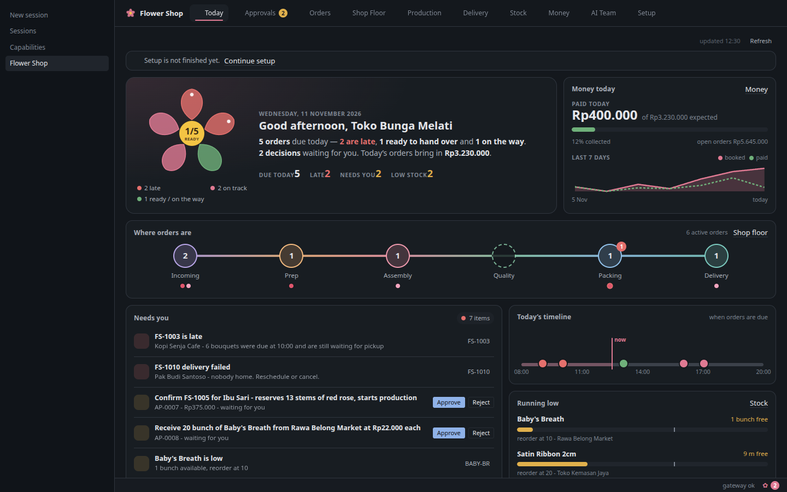
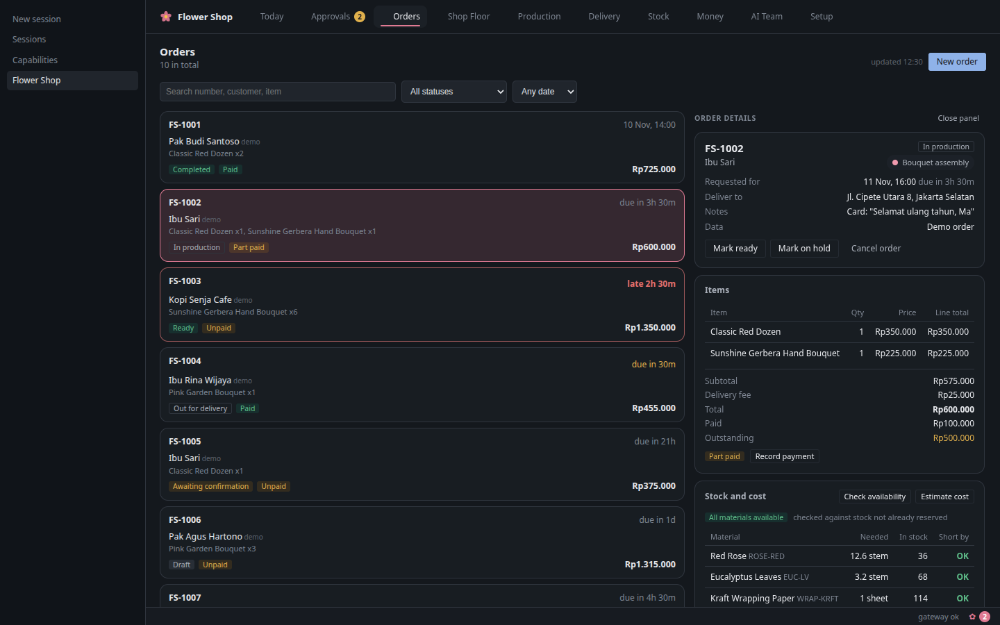
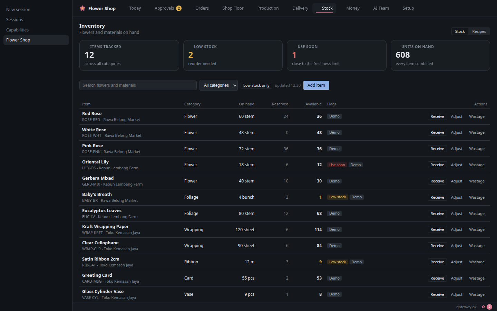
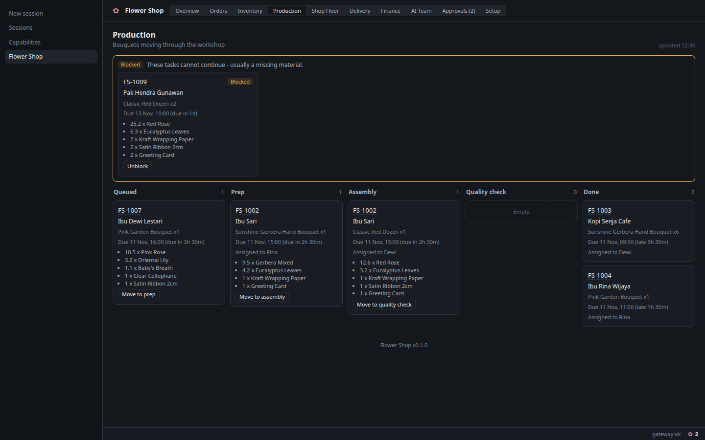
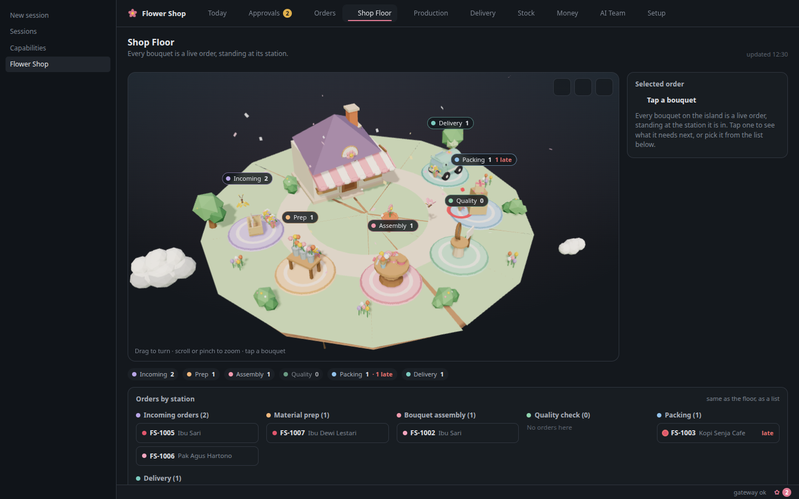
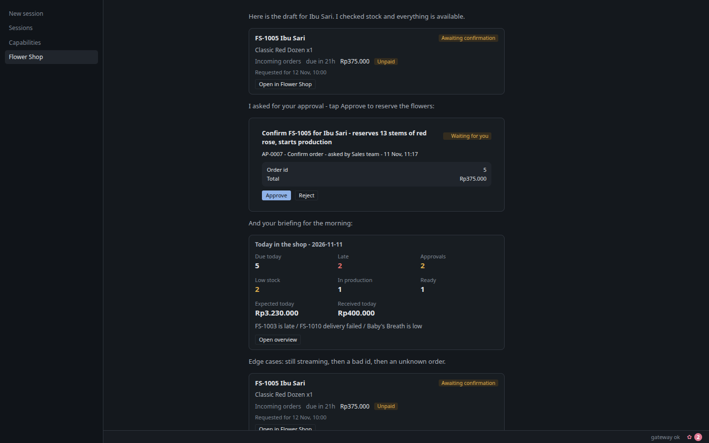
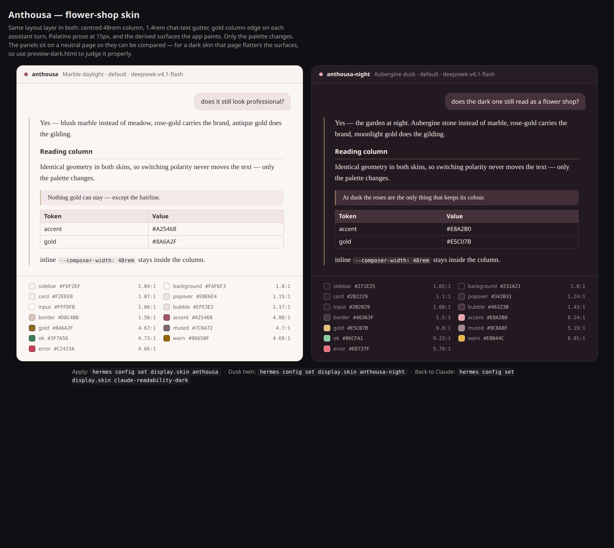

# Flower Shop

**Flower Shop is an AI business operating workspace inside Hermes.** A small
flower-shop owner talks to a coordinated AI team, follows the work on a native
Desktop workspace, and approves every consequential action — against one shared
record of orders, stock, production, deliveries, and money.

Requires **Hermes >= 0.22.0**.

## What it does

- **An AI team, not a chatbot.** A business manager plus five department agents
  (Sales, Inventory, Production, Finance, Logistics) work through controlled
  tools and one set of business records.
- **A native Desktop workspace.** Overview, Orders, Inventory + recipes,
  Production board, 3D Shop Floor, Delivery, Finance, AI Team, and an Approvals
  inbox are pages inside Hermes Desktop, not a separate dashboard.
- **One source of truth.** Agents and the UI call the same service layer and
  the same SQLite database. No department keeps its own copy of the truth.
- **The owner stays in control.** Consequential actions create a PENDING
  approval. The owner approves from an inline chat card, the Approvals inbox, or
  an explicit chat relay. Agents propose; the owner approves.

## Screenshots













## Theme — *Anthousa* (optional)

The repo ships a matching Hermes skin in [`theme/`](theme/): **Anthousa**, a
light "marble daylight" garden palette with a dark twin, **Anthousa Night**.
One YAML file per polarity, and it re-skins the Desktop GUI, the TUI and the
CLI from the same palette — so the workspace and the shell around it look like
the same product.



Nothing applies itself: installing the plugin never changes your theme. The
optional **Theme** beat in onboarding shows both variants and applies one only
when you click it, with an **Undo** that switches straight back. From a
terminal, the same two steps:

```bash
./theme/install-theme.sh                  # copy both skins; switches nothing
./theme/install-theme.sh --activate       # copy both, then switch to the marble twin
./theme/install-theme.sh --activate anthousa-night   # ...or the dusk twin
./theme/restore-theme.sh                  # back to whatever this machine had before
```

Every colour that lands as text clears WCAG AA on the surface it sits on; see
[`theme/README.md`](theme/README.md) for the palette table, the contrast audit
and the design rationale. The plugin does not depend on the theme — it is a
companion, not a requirement.

## Features

- **Overview** — what needs attention today: late orders, pending approvals,
  ready-but-unpaid orders, delivery risks, expected revenue, and data gaps.
- **Orders** — list and detail: customer, items, price, payment state, status
  history, allowed next steps.
- **Inventory + recipes** — stock on hand, reserved, and available; low-stock
  and freshness risks; bouquet recipes with components and wastage factors.
- **Production board** — tasks from queued to done across prep, assembly,
  quality check, with materials required, reserved, and consumed.
- **3D Shop Floor** — a low-poly, read-only view of the floor fed live by the
  production state. Orders appear as tokens at the station they are in.
- **Delivery** — schedule, assign, and track deliveries; status changes move the
  order.
- **Finance estimates** — recorded payments and expenses next to cost and margin
  estimates, always labelled as estimates.
- **AI Team** — the department roster, responsibilities, tools, and recent
  activity, in plain business language.
- **Approvals inbox + inline chat approval cards** — every gated action lands in
  one queue and also renders as a live card in chat with Approve / Reject.
- **Setup / onboarding + removable demo data** — a guided setup, and a demo shop
  that can be loaded and cleared without touching real records.

## It isn't only for flowers

**The flower shop is a demo, not a limit.** Nothing in the engine knows what a
rose is. What the plugin actually provides is a general shape for any small
physical business:

> one shared record of **what was ordered**, **what is in stock**, **what is
> being made**, **what is going out**, and **what was paid** — plus a team of
> agents that can only *propose* changes, and a queue where the owner approves
> them.

Anything that sells, makes and delivers a physical thing fits that shape: a
bakery, a coffee roaster, a print shop, a dry cleaner, a bike repair shop, a
caterer, a ceramics studio, a flower shop. Swap the vocabulary and the same
workspace holds up — *recipes* become formulas or job tickets, *stations*
become workbenches or machines, *delivery* becomes pickup or shipping.

Ways to make it yours, cheapest first:

| What | How |
|---|---|
| Your market | `POST /demo/seed {"locale": "id"}` loads the Indonesian demo instead of the default international (USD) one — see [`docs/API.md`](docs/API.md) |
| Your business | Set name, currency, timezone, location and opening hours in **Setup**, or through `flowershop_update_business_profile` |
| Your catalogue | Add your own SKUs, bouquet **recipes** and their components — the stock, cost and margin maths follows automatically |
| Your team | The five department skills in `skills/` are plain markdown: rewrite Sales / Inventory / Production / Finance / Logistics for your trade, or drop the ones you don't need |
| Your flow | Production stations, approval types and the order lifecycle live in `flowershop_core/services/` and the numbered SQL migrations — the same layer every agent and every screen already goes through |

The bundled **Anthousa** skin (below) is optional and swappable for the same
reason: it is a companion, not a requirement.

## How it works

```
+------------------------------------------------------------------+
| Hermes Desktop (Flower Shop workspace)                           |
|  Overview . Orders . Inventory . Production . Shop Floor 3D      |
|  Delivery . Finance . AI Team . Approvals                        |
+----------------------^-----------------------+-------------------+
                       | REST /api/plugins/   | plugin.flower-shop.changed
                       | flower-shop (ctx.rest)| (live invalidation)
+----------------------+-----------------------v-------------------+
| Flower Shop plugin                                              |
|  dashboard/plugin_api.py  ->  flowershop_core.services           |
|  agent tools (flowershop_*)  ->  flowershop_core.services       |
|  skills/ (manager + 5 department SKILL.md)                      |
+----------------------^------------------------------------------+
                       | stdlib sqlite3, migrations, BEGIN IMMEDIATE
                       v
   <HERMES_HOME>/plugin-data/flower-shop/flowershop.db
```

Neither the Desktop UI nor the agent tools touch SQL. Only
`flowershop_core.services` does, so every write is validated, transactional,
and audited with the acting department.

## Install

Requires Hermes >= 0.22.0.

```bash
hermes plugins install k-reeeee/hermes-flower-shop
```

Then enable it:

1. Add `flower-shop` to `plugins.enabled` in your Hermes `config.yaml`:
   ```yaml
   plugins:
     enabled:
       - flower-shop
   ```
2. Restart Hermes.
3. In Desktop, open **Capabilities -> Plugins** and enable **Flower Shop**.
4. Open the Flower Shop workspace and choose **Load demo shop** to start from a
   realistic dataset.

To remove the demo data later, use **Clear demo data** in the same place; it
deletes only rows marked as demo.

## Example prompts

Type these into the Hermes chat:

- "What needs attention today?"
- "Ibu Sari wants a dozen red roses delivered tomorrow at 10am to Jl. Kemang
  Raya 12, budget 400 thousand."
- "How many red roses do we have?"
- "What's the margin on FS-1012?"
- "We received 50 stems of red roses at Rp9,000 each from Rawa Belong."
- "Schedule FS-1012 for tomorrow at 10:00, Budi drives."

## Tools

Every tool takes an optional `department` argument and returns a JSON string.
Read-only tools run freely; gated tools only create a pending approval.

| Tool | Kind | Purpose |
|---|---|---|
| `flowershop_team_playbook` | read | Roster, department rules, approval policy |
| `flowershop_get_briefing` | read | Daily operational overview |
| `flowershop_get_business_profile` | read | Profile and onboarding state |
| `flowershop_update_business_profile` | write | Change profile fields |
| `flowershop_list_orders` | read | Order list |
| `flowershop_get_order` | read | Order detail |
| `flowershop_create_order_draft` | write | New draft order |
| `flowershop_update_order_draft` | write | Edit a draft |
| `flowershop_check_availability` | read | Required vs available stock |
| `flowershop_estimate_order` | read | Cost and margin estimate |
| `flowershop_request_order_confirmation` | approval | Confirm order, reserve stock |
| `flowershop_request_order_cancellation` | approval | Cancel an order |
| `flowershop_list_inventory` | read | Stock list |
| `flowershop_get_inventory_item` | read | One item + movements |
| `flowershop_create_inventory_item` | write | New SKU |
| `flowershop_propose_stock_receipt` | approval | Receive stock |
| `flowershop_propose_stock_adjustment` | approval | Correct a count (reason required) |
| `flowershop_propose_wastage` | approval | Record wastage (reason required) |
| `flowershop_list_recipes` | read | Bouquet recipes |
| `flowershop_create_recipe` | write | New recipe |
| `flowershop_list_production_tasks` | read | Production board |
| `flowershop_update_production_status` | write | Advance or block a task |
| `flowershop_schedule_delivery` | write | Book a delivery |
| `flowershop_update_delivery_status` | write | Move a delivery's status |
| `flowershop_list_deliveries` | read | Delivery list |
| `flowershop_get_financial_summary` | read | Recorded money + estimates |
| `flowershop_propose_payment` | approval | Record a payment |
| `flowershop_propose_expense` | approval | Record an expense |
| `flowershop_list_approvals` | read | Approval queue |
| `flowershop_decide_approval` | owner-relayed | Approve/reject from chat, quoting the owner |
| `flowershop_attach_design_reference` | write | Attach a bouquet image to an order |

## Approvals

Agents propose; the owner approves. These actions never execute from the agent
alone:

- Confirming or cancelling a customer order
- Receiving, adjusting, or writing off stock
- Recording a payment or an expense

A gated tool call does not perform the action. It creates a PENDING approval and
returns a directive. The agent shows the directive on its own line in chat, so
Desktop renders a live card with **Approve** and **Reject** buttons. The owner
can also decide from the Approvals inbox, or say yes in chat — that relay is
allowed only when the `chat_approvals` setting is enabled (it is **off by
default**) and the tool call quotes the owner's exact words; every relayed
decision still lands in Hermes' own approval gate for an explicit confirm (see
[Safety model](#safety-model)). Every decision is recorded as the owner, with a
note.

Read-only lookups and calculations run without approval. Every write identifies
the acting department and creates an audit event.

## Safety model

**Agents propose, the owner approves — everywhere, including chat.**

- Every gated action (order confirm/cancel, stock receipt/adjustment/wastage,
  payment, expense) creates a **PENDING approval**; nothing executes from the
  agent alone. The owner approves with a click on the chat card or the
  Approvals inbox.
- **Chat relay is off by default.** `chat_approvals` defaults to `false`, so
  `flowershop_decide_approval` is refused and decisions only happen through the
  Desktop Approve / Reject buttons. Enabling it lets the owner say "yes" in
  chat — but even then the decision itself is escalated to **Hermes' own
  human-approval gate**: the plugin registers a `pre_tool_call` hook that
  escalates `flowershop_decide_approval` to a host-level confirm naming the
  decision, approval ref, action and amount. The hook fails closed (an
  unreadable approval still ends up in the approval gate, never silently
  passed) and never raises.
- Read-only lookups and calculations run freely. Every write is audited with
  the acting department.

## Design assets

Bouquet images and design references are **files in the plugin's uploads
folder** — the plugin only ever records and serves files from there.

| Topic | Rule |
|---|---|
| Where the folder is | `<HERMES_HOME>/plugin-data/flower-shop/uploads` — i.e. `~/.hermes/plugin-data/flower-shop/uploads` on Linux/macOS, `%USERPROFILE%\.hermes\plugin-data\flower-shop\uploads` on Windows. Open it with your file manager. |
| Naming | `<order#>-<short-desc>.<ext>` — e.g. `FS-1042-peony-ref.jpg`. |
| Allowed types / size | `.png` `.jpg` `.jpeg` `.webp` `.gif`; keep each file at or under **10 MB**. |
| One folder per shop | Single-shop plugin: everything lives in that one `uploads/` folder, not one folder per order. |
| Backup | Copy `uploads/` **together with** `flowershop.db` — the database holds the references, the folder holds the bytes. |
| Never point at personal folders | Do not reference `Desktop/`, `Downloads/` or any folder outside `uploads/`; the plugin rejects those paths and tells you where to put the file instead. |
| Deleting a file | Breaks the reference: the order page then shows the image as missing. |

The agent never writes into `uploads/` itself: it has no copy-in path, and its
tool schema tells it to **ask the owner to add the image** to the uploads
folder when a referenced file is not there.

## The AI team is optional

Setup ends with an optional team step. **You can run the whole shop with one
assistant and add team members later anytime.** The agent only *suggests*
assistant names — free-form, e.g. `sales`, `florist`, `delivery` (the bundled
`flower-shop-<department>` profiles are just an example) — and records them as
`suggested`. It never creates Hermes profiles itself. Real profiles are made
by you on the Desktop **Setup → Assistant profiles** step (the **Create**
button) or from a terminal:

```bash
hermes profile create sales
hermes profile create florist
```

Example prompts for the chat:

- "Suggest a team for my shop"
- "Create profiles: sales, florist, delivery as a team to handle weekend orders"

## Data and privacy

- All business data lives in one SQLite database at
  `<HERMES_HOME>/plugin-data/flower-shop/flowershop.db`.
- The plugin makes **no network calls**, sends **no telemetry**, and stores **no
  credentials**.
- It runs **no shell commands** and reads nothing outside its own data directory.
- Demo data is marked as demo and can be cleared from the workspace.

## Limitations

- **Not an accounting ledger.** Finance numbers are operational estimates plus
  what you recorded. It is not tax-ready or bookkeeping software.
- **WhatsApp intake** works only through the Hermes gateway you already have
  configured; there is no special WhatsApp parsing in this plugin.
- **Image generation** uses Hermes' built-in image tool; the plugin stores the
  reference, it does not generate images itself.
- **The bouquet canvas is not built.** Design references are images attached to
  orders.
- **Single shop, single user.** One database, one business profile; no
  multi-branch or multi-staff access control.
- The **3D Shop Floor is read-only**; all state changes happen through tools or
  the board.

## Development

Layout:

```
flower-shop/
  plugin.yaml            manifest
  flowershop_core/       services, tools, migrations, seed (the only SQL)
  dashboard/             REST bridge
  desktop/               ESM sources + built plugin.js
  skills/                manager + 5 department SKILL.md
  scripts/               build-desktop.mjs
  tests/                 unit, integration, desktop
```

```bash
node scripts/build-desktop.mjs   # rebuild desktop/plugin.js
python3 -m pytest tests          # backend tests
hermes plugins validate .        # catalog admission gate
```

## License

MIT. See [LICENSE](LICENSE).
